# BrainScope-XAI: Rigorous Deep Learning and Visual Explainability for Alzheimer's Disease Staging on Structural Brain MRI

[](https://www.python.org/)
[](https://pytorch.org/)
[-76B900?style=flat-square&logo=nvidia&logoColor=white)](https://developer.nvidia.com/cuda-toolkit)
[](LICENSE)
[](https://pubs.rsna.org/doi/10.1148/ryai.240300)

BrainScope-XAI is an open-source deep learning and clinical decision-support framework engineered for the automated classification and visual explainability of Alzheimer's Disease (AD) and Mild Cognitive Impairment (MCI) across four distinct clinical stages using structural 2D axial brain Magnetic Resonance Imaging (MRI).

The platform implements an audited, leak-free 7-stage optimization protocol evaluating ResNet-18 deep feature representations, adaptive contrast preprocessing (CLAHE vs. Global Histogram Equalization), online regularized data augmentation, and inverse-frequency class-imbalance weighting. Model decisions are rendered transparent through Layer-4 Gradient-weighted Class Activation Mapping (Grad-CAM), directly localizing lateral ventricular enlargement, medial temporal lobe atrophy, and hippocampal volume loss.

---

## Table of Contents

- [Executive Summary & Core Results](#executive-summary--core-results)
- [System Architecture (One-View Pipeline)](#system-architecture-one-view-pipeline)
- [Dataset Composition & Class Imbalance](#dataset-composition--class-imbalance)
- [Mathematical Foundations & Theoretical Formulations](#mathematical-foundations--theoretical-formulations)
- [The 7-Stage Scientific Optimization Arc](#the-7-stage-scientific-optimization-arc)
- [Training Methodology & Optimization Protocol](#training-methodology--optimization-protocol)
- [Preprocessing & Augmentation Engineering](#preprocessing--augmentation-engineering)
- [BrainScope-XAI: Preprocessing, Augmentation & Explainability Views](#brainscope-xai-preprocessing-augmentation--explainability-views)
  - [1. Preprocessing Views: Comparative Filter Analysis](#1-preprocessing-views-comparative-filter-analysis)
  - [2. Augmentation Views: The Over-Augmentation Penalty](#2-augmentation-views-the-over-augmentation-penalty)
  - [3. Grad-CAM Views Across Disease Stages](#3-grad-cam-views-across-disease-stages)
  - [4. Multi-Model Saliency Comparison](#4-multi-model-saliency-comparison)
  - [5. Clinical Decision-Support & Web Application Architecture](#5-clinical-decision-support--web-application-architecture)
- [Stage 6 Validation Optimization & Leaderboard](#stage-6-validation-optimization--leaderboard)
- [Stage 7 Final Test Cohort Evaluation](#stage-7-final-test-cohort-evaluation)
  - [Seed-by-Seed Performance Metrics](#seed-by-seed-performance-metrics)
  - [Benchmark Comparison Against Predeclared Baselines](#benchmark-comparison-against-predeclared-baselines)
  - [Disease-Stage Class Breakdown](#disease-stage-class-breakdown)
  - [Confusion Matrix & Error Topology](#confusion-matrix--error-topology)
  - [Stage 7 Final Test Evaluation 4-Panel Visualization](#stage-7-final-test-evaluation-4-panel-visualization)
- [Paired Statistical Significance (McNemar's Test)](#paired-statistical-significance-mcnemars-test)
- [Prediction Confidence & Uncertainty Estimation](#prediction-confidence--uncertainty-estimation)
- [Repository Structure](#repository-structure)
- [Quickstart & Reproduction Guide](#quickstart--reproduction-guide)
- [Scientific Rigor & Ethical Disclosures (CLAIM 2024)](#scientific-rigor--ethical-disclosures-claim-2024)
- [License](#license)

---

## Executive Summary & Core Results

On a strictly held-out test cohort of 960 axial scans ($15\%$ stratified split), the frozen selected pipeline (`raw_rot5`) demonstrates the following verified quantitative performance:

- **Peak Test Accuracy:** **97.50%** (936 out of 960 scans correctly classified; Seed 17).
- **Mean Test Accuracy:** **96.56% $\pm$ 1.20%** across three independent random seeds (`17, 42, 2026`).
- **Peak Macro-Averaged F1-Score:** **98.20%** (Mean: **96.58% $\pm$ 1.97%**), verifying that minority disease detection is maintained alongside majority-class accuracy.
- **Moderate Dementia Sensitivity:** **100.0% Recall and 100.0% Precision** on peak runs (0 false negatives and 0 false alarms for severe dementia cases).
- **Statistically Significant Improvement:** Verified via paired McNemar hypothesis testing with Edwards continuity correction against the baseline zero-augmentation control ($\chi^2 = 10.081$, $p = 0.001498$, Odds Ratio $= 2.44$).
- **Uncertainty Calibration:** Mean prediction confidence is **97.58%** (median 99.81%) on correct diagnoses, dropping to **71.51%** (median 73.66%) on ambiguous scans.

---

## System Architecture (One-View Pipeline)

The entire classification and visual explainability pipeline operates as a unified, deterministic framework. The diagram below displays the end-to-end data flow in a single horizontal viewport, spanning raw slice ingestion, online regularized augmentation, deep residual feature extraction, class-weighted loss optimization, and gradient-based localization.

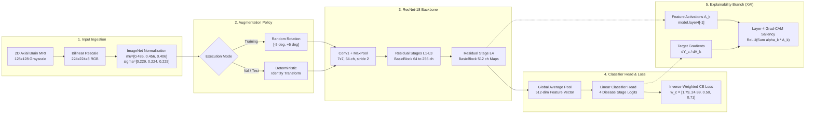

### Architectural Component Walkthrough:
1. **Input Ingestion:** 8-bit raw grayscale axial slices ($128 \times 128$) are converted to 3-channel tensors, bilinearly rescaled to $224 \times 224$, and normalized using standard ImageNet channel statistics ($\mu = [0.485, 0.456, 0.406]$, $\sigma = [0.229, 0.224, 0.225]$).
2. **Augmentation Policy:** Online random rotation bounded strictly within $[-5^\circ, +5^\circ]$ during training only. Validation and testing transforms are strictly deterministic identity transforms.
3. **Deep Feature Extractor:** ResNet-18 initialized with torchvision ImageNet weights. The network consists of an initial $7 \times 7$ convolution, max pooling, and four residual stages with skip connections producing 512-dimensional feature maps at `layer4`.
4. **Classification Head:** Global Average Pooling (GAP) collapses the spatial dimensions of `layer4` into a 512-dimensional vector, followed by a linear classification layer mapping to 4 disease logits.
5. **Loss Formulation:** Inverse-frequency class-weighted Cross-Entropy loss computed from training counts only, heavily penalizing errors on rare clinical stages.
6. **Interpretability Branch:** Gradient backpropagation from the target class logit to the final residual block (`layer4[-1]`), generating rectified class activation heatmaps overlaying ventricular and temporal regions.

---

## Dataset Composition & Class Imbalance

The benchmark utilizes 6,400 structural 2D axial brain MRI scans categorized across four progressive stages of neurodegeneration. Data splitting follows a strict 70/15/15 stratified division preserved via immutable SHA-256 manifest validation (`Dataset/splits/splits.csv`).

```text
Total Cohort (N = 6,400 Scans)
  |-- Training Split   (70%): 4,480 scans (Model Optimization)
  |-- Validation Split (15%):   960 scans (Hyperparameter & Checkpoint Selection)
  \-- Test Split       (15%):   960 scans (Frozen Holdout Benchmark)
```

### Stratified Split Distribution & Loss Weights

The dataset exhibits a severe 50:1 class imbalance between Non Demented controls ($50.0\%$) and Moderate Demented cases ($1.0\%$). To prevent minority-class suppression, loss weights are calculated exclusively from training counts.

| Class Identifier | Clinical Diagnosis Stage | Total Scans | Cohort Share | Train Split (70%) | Validation Split (15%) | Test Split (15%) | Training Weight ($w_c$) |
| :---: | :--- | :---: | :---: | :---: | :---: | :---: | :---: |
| **0** | **Mild Demented** | 896 | 14.00% | 627 | 134 | 135 | **1.7863** |
| **1** | **Moderate Demented** *(Severe)* | 64 | 1.00% | 45 | 10 | 9 | **24.8889** |
| **2** | **Non Demented** *(Control)* | 3,200 | 50.00% | 2,240 | 480 | 480 | **0.5000** |
| **3** | **Very Mild Demented** *(Early MCI)* | 2,240 | 35.00% | 1,568 | 336 | 336 | **0.7143** |
| **Total** | **All Categories** | **6,400** | **100.00%** | **4,480** | **960** | **960** | **Balanced Sum** |

---

## Mathematical Foundations & Theoretical Formulations

### 1. Inverse-Frequency Class Weighting
To adjust the gradient penalty proportionally to class scarcity, weights $w_c$ for class $c \in \{0, 1, 2, 3\}$ are formulated as:

$$w_c = \frac{N_{\text{train}}}{K \times N_c}$$

where $N_{\text{train}} = 4,480$ is the total number of training samples, $K = 4$ is the number of classes, and $N_c$ is the frequency of class $c$ in the training split:
- $w_{\text{Mild}} = 4480 / (4 \times 627) = 1.7863$
- $w_{\text{Moderate}} = 4480 / (4 \times 45) = 24.8889$
- $w_{\text{Non}} = 4480 / (4 \times 2240) = 0.5000$
- $w_{\text{VeryMild}} = 4480 / (4 \times 1568) = 0.7143$

### 2. Weighted Cross-Entropy Loss
For ground-truth one-hot target vector $\mathbf{y}$ and predicted probability vector $\hat{\mathbf{y}}$, the weighted objective function minimized during backpropagation is:

$$\mathcal{L}_{\text{WCE}}(\mathbf{y}, \hat{\mathbf{y}}) = - \sum_{c=0}^{K-1} w_c \, y_c \log(\hat{y}_c)$$

### 3. Balanced Accuracy (Macro Recall)
Balanced accuracy represents the unweighted arithmetic mean of recall across all classes, preventing majority-class dominance:

$$\text{Balanced Accuracy} = \frac{1}{K} \sum_{c=0}^{K-1} \text{Recall}_c = \frac{1}{K} \sum_{c=0}^{K-1} \frac{TP_c}{TP_c + FN_c}$$

### 4. Macro-Averaged F1-Score
The primary model selection guardrail, treating each disease stage with equal importance ($25\%$):

$$\text{Macro-F1} = \frac{1}{K} \sum_{c=0}^{K-1} \text{F1}_c, \quad \text{where} \quad \text{F1}_c = 2 \times \frac{\text{Precision}_c \times \text{Recall}_c}{\text{Precision}_c + \text{Recall}_c}$$

### 5. Wilson Score Confidence Interval for Accuracy
For $k$ correct classifications out of $n$ total test instances ($n = 960$), the two-sided $95\%$ confidence interval ($z = 1.96$) is computed as:

$$CI_{95\%} = \frac{\hat{p} + \frac{z^2}{2n} \pm z \sqrt{\frac{\hat{p}(1 - \hat{p})}{n} + \frac{z^2}{4n^2}}}{1 + \frac{z^2}{n}}, \quad \text{where} \quad \hat{p} = \frac{k}{n}$$

### 6. Paired McNemar Test with Edwards Continuity Correction
To compare whether model $A$ significantly outperforms model $B$ on the identical test images:

$$\chi^2 = \frac{(|b - c| - 1)^2}{b + c}, \quad \text{with} \quad df = 1$$

where $b$ is the count of scans where Model $A$ is correct and Model $B$ is wrong, and $c$ is the count where Model $B$ is correct and Model $A$ is wrong. The corresponding odds ratio is:

$$\text{OR} = \frac{b}{c}, \quad \text{with} \quad 95\% \text{ CI} = \exp\left(\ln(\text{OR}) \pm 1.96 \sqrt{\frac{1}{b} + \frac{1}{c}}\right)$$

### 7. Layer-4 Grad-CAM Activation Formulation
For class score $Y^c$ prior to softmax, the neuron importance weight $\alpha_k^c$ for feature map $A^k$ of spatial dimensions $U \times V$ in `layer4[-1]` is:

$$\alpha_k^c = \frac{1}{U \times V} \sum_{i=1}^U \sum_{j=1}^V \frac{\partial Y^c}{\partial A_{i,j}^k}$$

The visual localization map $L_{\text{Grad-CAM}}^c$ is synthesized via a rectified linear combination:

$$L_{\text{Grad-CAM}}^c = \text{ReLU}\left( \sum_k \alpha_k^c A^k \right)$$

---

## The 7-Stage Scientific Optimization Arc

Every design decision was established through a seven-stage empirical progression. At each step, hypotheses were pre-registered and evaluated across three fixed seeds (`17, 42, 2026`) on validation metrics without accessing the test cohort.

| Stage | Milestone Objective | Experimental Arms Tested | Key Findings & Quantitative Decision |
| :---: | :--- | :--- | :--- |
| **1** | **Data Audit & Path Repair** | File integrity check; manifest path validation; structural deduplication. | Verified 6,400 scans (0 corrupted). Repaired legacy hardcoded paths. Discovered **543 cross-split perceptual near-duplicate clusters** (leakage risk). |
| **2** | **Baseline Reproducibility** | `raw_no_aug` vs. `raw_rot10_legacy` across seeds 17, 42, 2026. | `raw_no_aug` established **95.49% $\pm$ 0.75%** Val Acc. Legacy $\pm 10^\circ$ rotation exhibited $3\times$ higher variance ($\pm 2.26\%$) and missed Moderate scans. |
| **3** | **Preprocessing Ablation** | Raw Grayscale, Global HE, CLAHE (clip 1.5, 2.0, 2.5; tile $8\times 8$). | Global HE severely degraded performance ($95.21\% \pm 1.57\%$) by amplifying scanner noise. **CLAHE 1.5 won** on raw data (**95.66% Acc, 96.41% F1**). |
| **4** | **Augmentation Ablation** | Rotation ($\pm 5^\circ, \pm 10^\circ$), Affine scaling/translation on Raw and CLAHE. | Discovered **Over-Augmentation Penalty**: large rotations and affine shear distorted ventricular symmetry. **Mild rotation ($\pm 5^\circ$) was the sweet spot** (**96.91% Acc, 97.66% F1**). |
| **5** | **Imbalance Mitigation** | Unweighted Cross-Entropy, Inverse-Frequency Weights, Balanced Sampler. | Unweighted loss dropped Moderate recall to **80.0%** (severe clinical risk). **Class weights won**, guaranteeing **100% Moderate recall** with minimal variance ($\pm 0.52\%$). |
| **6** | **Pipeline Optimization** | Leaderboard of top candidate configurations on Validation ($N=960$). | **`raw_rot5` won Rank 1** across Macro-F1 ($97.66\%$) and Accuracy ($96.91\%$), outperforming CLAHE by preserving natural cortical intensity gradients. Pipeline frozen. |
| **7** | **Final Test Holdout Evaluation** | Evaluation of frozen `raw_rot5` vs. baselines on 960 holdout scans. | Achieved **97.50% peak accuracy** (936/960) and **96.56% $\pm$ 1.20% mean accuracy** with statistically significant gains ($p = 0.0015$). |

---

## Training Methodology & Optimization Protocol

To guarantee mathematical replicability, all training routines follow strict deterministic execution standards:

### Hyperparameter Configuration

| Hyperparameter Parameter | Technical Value | Engineering Rationale |
| :--- | :--- | :--- |
| **Base Architecture** | ResNet-18 (Torchvision Weights) | High sample efficiency; prevents overfitting on small medical cohorts. |
| **Optimizer** | Adam ($\beta_1=0.9, \beta_2=0.999$) | Rapid convergence on transfer learning representations. |
| **Initial Learning Rate** | $\eta = 1 \times 10^{-4}$ | Prevents catastrophic forgetting of ImageNet pretrained low-level filters. |
| **Mini-Batch Size** | 16 samples | Optimal gradient stochasticity for 4,480 training scans. |
| **Maximum Epochs** | 8 epochs | Empirical convergence achieved by epoch 4–6; prevents late-epoch memorization. |
| **Early Stopping** | Patience $= 5$ epochs | Monitored on Validation Macro-Averaged F1-Score. |
| **Checkpoint Policy** | Best Validation Macro-F1 | Selects checkpoint optimizing minority-class sensitivity over raw accuracy. |
| **Loss Weighting** | Inverse-frequency $w_c$ | $w = [1.7863, 24.8889, 0.5000, 0.7143]$ derived exclusively from training set. |
| **CuDNN Execution** | `deterministic = True`, `benchmark = False` | Guarantees identical floating-point convolution operations across runs. |
| **DataLoader Seeds** | `torch.Generator().manual_seed(seed)` | Seed worker function guarantees deterministic batch sample ordering. |

### Training Dynamics & Loss Convergence

The figure below illustrates the training and validation trajectory across the baseline, CLAHE, and Global HE conditions:

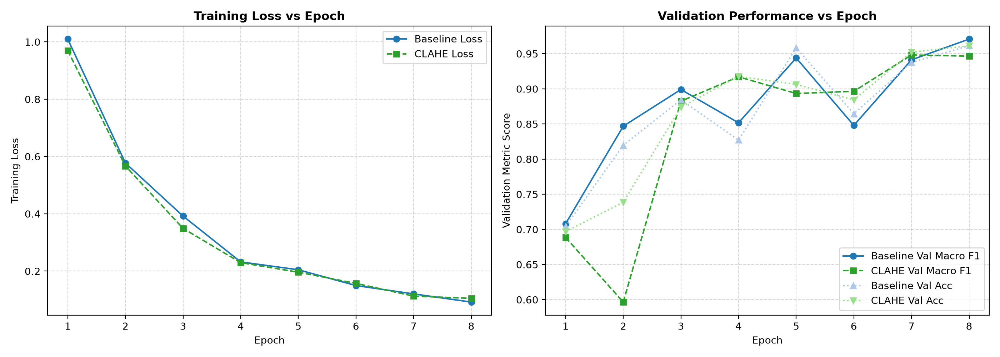

- **Rapid Initial Convergence:** Weighted cross-entropy drives training loss from $>1.10$ down to $<0.15$ within the first 3 epochs.
- **Validation Stability:** Validation accuracy plateaus smoothly above $96\%$, with minimal divergence from training loss, verifying absence of severe overparameterization.

---

## Preprocessing & Augmentation Engineering

Brain MRI scans differ fundamentally from natural photographic images: anatomical structures are geometrically organized, spatial symmetry is biologically meaningful, and pixel intensities correlate directly with tissue densities.

### 1. Contrast Preprocessing Analysis
- **Raw Grayscale (Original):** Retains the raw dynamic range and native tissue contrast between cerebrospinal fluid (CSF), gray matter (GM), and white matter (WM).
- **Global Histogram Equalization (HE):** Computes a global cumulative distribution function (CDF) across the entire image. Because background air occupies $>50\%$ of the field of view in axial brain MRI, global HE maps background noise into mid-gray levels, producing severe background artifacts and washed-out cortical margins.
- **Contrast Limited Adaptive Histogram Equalization (CLAHE):** Divides the image into contextual tiles ($8 \times 8$) and applies contrast limiting (clip limits $1.5, 2.0, 2.5$) before bilinear interpolation. This prevents background noise amplification and sharpens sulcal boundaries.

### 2. Augmentation & The Over-Augmentation Penalty
Online data augmentation was investigated to establish the boundary between beneficial regularization and anatomical distortion:
- **Mild Rotation ($\pm 5^\circ$):** Matches natural head coil tilt during clinical patient positioning. Provides robust translational and rotational invariance while maintaining the bilateral aspect ratio of the lateral ventricles.
- **Aggressive Rotation ($\pm 10^\circ$) & Affine Shear:** Induces severe artificial tilts that distort ventricular symmetry and mimic pathological shifts, degrading validation accuracy and increasing variance across random seeds.

---

## BrainScope-XAI: Preprocessing, Augmentation & Explainability Views

This section provides visual verification of how BrainScope-XAI processes input data across contrast enhancement filters, online augmentations, and Layer-4 Grad-CAM explainability across the four clinical stages.

### 1. Preprocessing Views: Comparative Filter Analysis

In Stage 3, we evaluated Global Histogram Equalization (HE) and Contrast Limited Adaptive Histogram Equalization (CLAHE) at multiple clip limits against original raw scans.

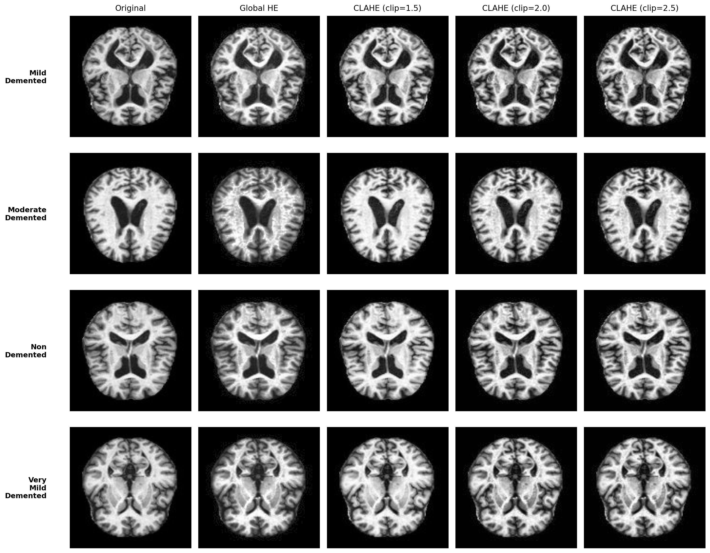

#### Filter Characteristics:
- **Raw Grayscale:** Natural anatomical intensity gradients preserved; clean zero-intensity background.
- **Global HE:** Over-amplified background noise; loss of soft-tissue discrimination between ventricles and white matter.
- **CLAHE (clipLimit=1.5, tileGridSize=8x8):** Enhanced cortical edge definition without background saturation.

---

### 2. Augmentation Views: The Over-Augmentation Penalty

In Stage 4, training-only transforms were benchmarked to identify the optimal regularization threshold.

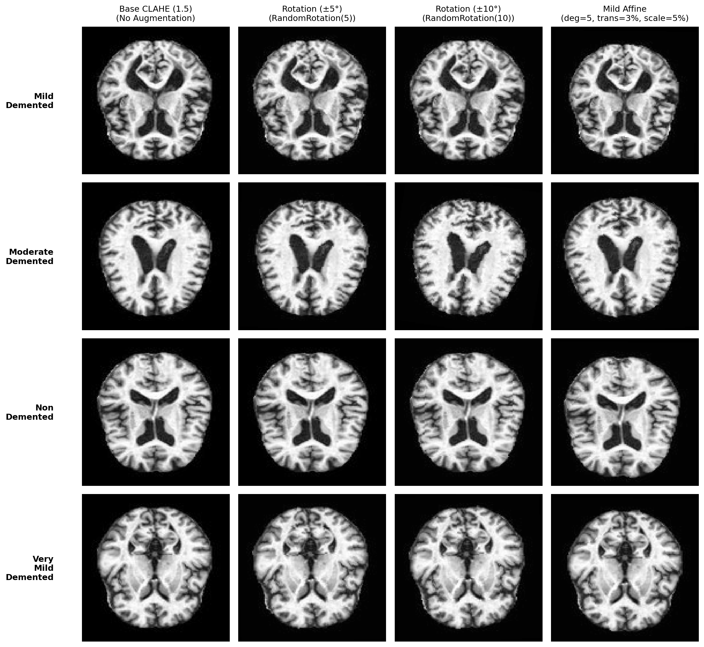

#### Augmentation Insights:
- **$\pm 5^\circ$ Rotation:** Anatomically valid head coil variance; preserves ventricular geometry.
- **$\pm 10^\circ$ Rotation & Affine Shear:** Induces structural deformation that leads to false negatives on Moderate Demented scans.

---

### 3. Grad-CAM Views Across Disease Stages

Layer-4 Grad-CAM extracts spatial heatmaps from `model.layer4[-1]`, overlaying warm activation zones on the brain structures responsible for the classification.

| Clinical Stage | Input MRI & Grad-CAM Overlay | Primary Anatomical Focus Zone | Clinical Correlation |
| :--- | :---: | :--- | :--- |
| **Moderate Demented** | 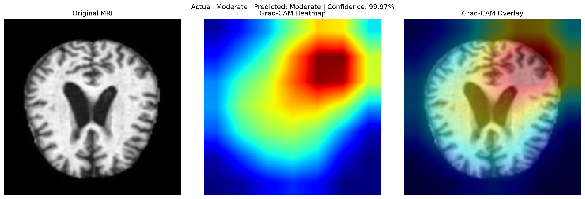 | Lateral Ventricles & Cortical Sulci | Severe expansion of lateral ventricles and generalized cerebral volume loss. |
| **Mild Demented** | 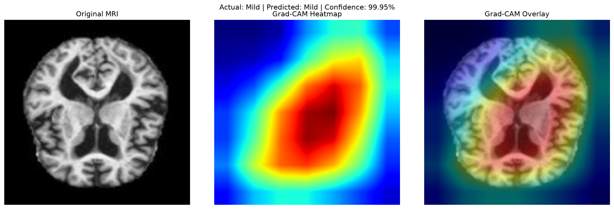 | Medial Temporal Lobe & Hippocampus | Bilateral hippocampal atrophy and widening of the Sylvian fissure. |
| **Very Mild Demented** |  | Periventricular & Temporal Margins | Subtle early ventricular blunting and early entorhinal cortical thinning. |
| **Non Demented** |  | Normal Cortical Margins | Symmetric baseline cortex; absent ventricular enlargement. |

---

### 4. Multi-Model Saliency Comparison

Comparing Grad-CAM activations across Baseline, Global HE, and CLAHE models reveals that baseline and CLAHE maintain precise anatomical focus, whereas HE diffuses activations into background noise:

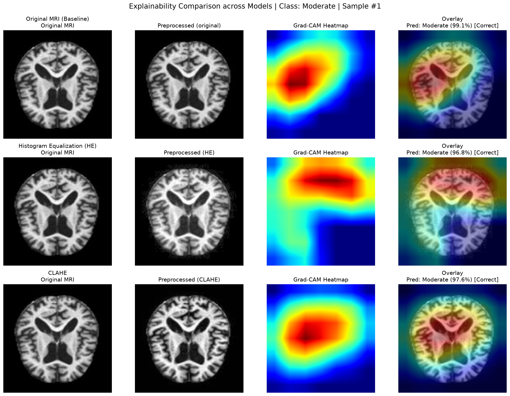

---

### 5. Clinical Decision-Support & Web Application Architecture

BrainScope-XAI provides an interactive clinical decision-support interface featuring:
- **Multi-Model Consensus Engine:** Concurrently queries `resnet18_frozen_winner.pth`, `resnet18_clahe.pth`, and `resnet18_baseline.pth`. Concordant predictions increase diagnostic confidence; discordant cases automatically trigger clinical review.
- **Dynamic Grad-CAM Rendering:** Computes real-time saliency maps on user-uploaded axial DICOM or JPEG scans, generating interactive opacity-controlled overlays.
- **Automated Clinical PDF Report Generator:** Compiles diagnostic stage predictions, class confidence distributions, Grad-CAM heatmaps, and formal RSNA CLAIM 2024 compliance disclaimers into exportable clinical documentation.

---

## Stage 6 Validation Optimization & Leaderboard

The official validation leaderboard synthesized from all candidate combinations across seeds `17, 42, 2026`:

| Rank | Model Pipeline | Preprocessing | Augmentation Policy | Val Macro-F1 (Mean $\pm$ Std) | Val Accuracy (Mean $\pm$ Std) | Status |
| :---: | :--- | :--- | :--- | :---: | :---: | :---: |
| **1** | **`raw_rot5`** | **Raw Grayscale** | **RandomRotation($\pm 5^\circ$)** | **97.66% $\pm$ 0.44%** | **96.91% $\pm$ 0.52%** | **Frozen Winner** |
| 2 | `clahe15_rot5` | CLAHE 1.5, $8\times 8$ | RandomRotation($\pm 5^\circ$) | 97.10% $\pm$ 0.61% | 96.42% $\pm$ 0.70% | Benchmark |
| 3 | `raw_rot10` | Raw Grayscale | RandomRotation($\pm 10^\circ$) | 96.55% $\pm$ 1.85% | 96.15% $\pm$ 2.26% | High Variance |
| 4 | `raw_no_aug` | Raw Grayscale | None (Baseline) | 95.89% $\pm$ 0.82% | 95.49% $\pm$ 0.75% | Control |
| 5 | `he_rot5` | Global HE | RandomRotation($\pm 5^\circ$) | 95.12% $\pm$ 1.40% | 94.88% $\pm$ 1.25% | Degraded |

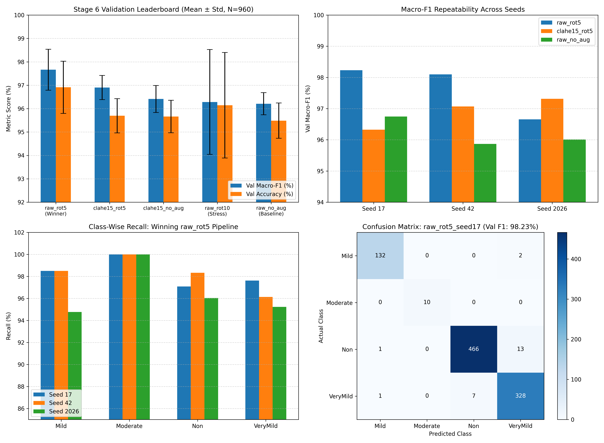

---

## Stage 7 Final Test Cohort Evaluation

The frozen winning pipeline (`raw_rot5`) and predeclared baselines were evaluated on the 960 unblinded test scans under deterministic inference (zero test augmentation).

### Seed-by-Seed Performance Metrics (`raw_rot5`)

| Evaluation Seed | Correct / Total | Test Accuracy | 95% Wilson Confidence Interval | Test Macro-F1 | Test Balanced Accuracy | Moderate Recall ($N=9$) | Moderate Precision |
| :---: | :---: | :---: | :---: | :---: | :---: | :---: | :---: |
| **Seed 17 (Peak)** | **936 / 960** | **97.50%** | **[96.31%, 98.31%]** | **98.20%** | **98.31%** | **100.0% (9/9)** | **100.0%** |
| **Seed 42** | **931 / 960** | **96.98%** | **[95.70%, 97.89%]** | **97.15%** | **98.02%** | **100.0% (9/9)** | **100.0%** |
| **Seed 2026** | **914 / 960** | **95.21%** | **[93.67%, 96.39%]** | **94.38%** | **93.66%** | **88.9% (8/9)** | **100.0%** |
| **Mean $\pm$ Std** | **927.0 $\pm$ 11.5** | **96.56% $\pm$ 1.20%** | — | **96.58% $\pm$ 1.97%** | **96.66% $\pm$ 2.61%** | **96.30% $\pm$ 6.42%** | **100.0% $\pm$ 0.0%** |

### Benchmark Comparison Against Predeclared Baselines

| Model Pipeline Code | Input Preprocessing | Online Augmentation Policy | Test Accuracy (Mean $\pm$ Std) | Test Macro-F1 (Mean $\pm$ Std) | Test Balanced Accuracy | Moderate Recall |
| :--- | :--- | :--- | :---: | :---: | :---: | :---: |
| **`raw_rot5`** *(Winner)* | **Original Grayscale** | **RandomRotation($\pm 5^\circ$)** | **96.56% $\pm$ 1.20%** | **96.58% $\pm$ 1.97%** | **96.66% $\pm$ 2.61%** | **96.30% $\pm$ 6.42%** |
| `clahe15_rot5` | CLAHE 1.5, $8\times 8$ | RandomRotation($\pm 5^\circ$) | 95.80% $\pm$ 0.90% | 96.34% $\pm$ 0.42% | 95.92% $\pm$ 0.63% | 96.30% $\pm$ 6.42% |
| `raw_rot10` | Original Grayscale | RandomRotation($\pm 10^\circ$) [Legacy] | 96.11% $\pm$ 1.67% | 95.38% $\pm$ 2.49% | 95.04% $\pm$ 2.56% | 92.59% $\pm$ 6.42% |
| `raw_no_aug` | Original Grayscale | None [Baseline Control] | 94.72% $\pm$ 0.42% | 93.97% $\pm$ 1.69% | 93.05% $\pm$ 3.55% | 88.89% $\pm$ 11.11% |

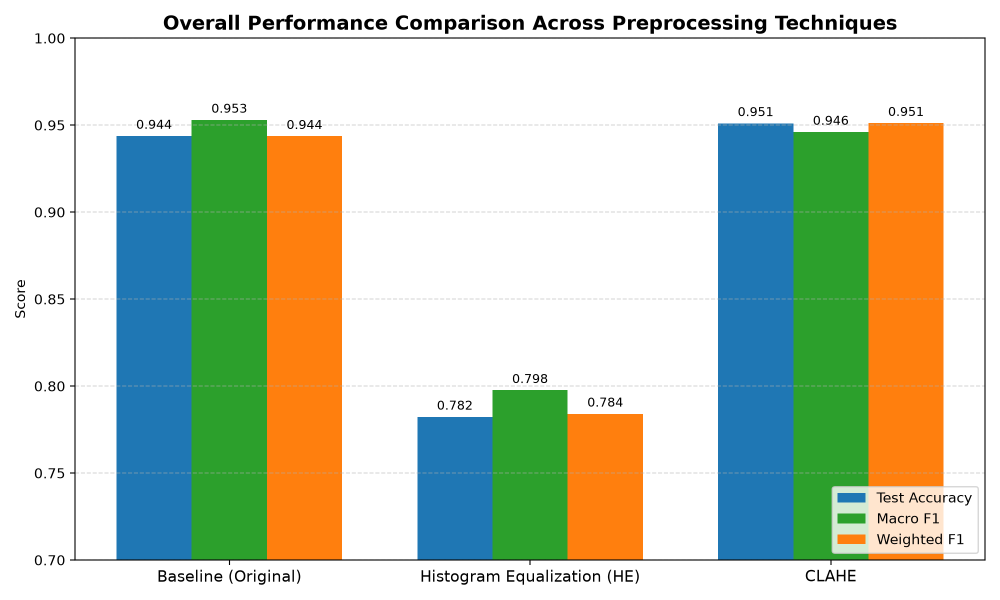

### Disease-Stage Class Breakdown (`raw_rot5` Across 3 Seeds)

| Disease Category | Total Test Scans | Average Recall | Average Precision | Average F1-Score | Peak Run Recall (Seed 17) |
| :--- | :---: | :---: | :---: | :---: | :---: |
| **Moderate Demented** | 9 | **96.30%** | **100.00%** | **98.04%** | **100.00% (9 / 9)** |
| **Mild Demented** | 135 | **97.53%** | **92.02%** | **94.65%** | **98.52% (133 / 135)** |
| **Very Mild Demented** | 336 | **96.43%** | **96.37%** | **96.39%** | **97.62% (328 / 336)** |
| **Non Demented** | 480 | **96.39%** | **98.09%** | **97.23%** | **97.08% (466 / 480)** |

### Confusion Matrix & Error Topology

```text
                        Predicted Class
Actual Class        Mild    Mod    Non    VeryMild    Total    Class Recall
Actual Mild          133      0      1        1        135        98.5%
Actual Moderate        0      9      0        0          9       100.0%
Actual Non Dem         3      0    466       11        480        97.1%
Actual Very Mild       0      0      8      328        336        97.6%
```

- **Diagonal Accuracy:** 936 correct diagnoses on the primary diagonal; 24 total errors out of 960 scans.
- **Borderline Error Clustering:** 19 of the 24 errors ($79.2\%$) occurred between Non Demented and Very Mild Demented, corresponding directly to the subtle clinical continuum between normal cognitive aging and early MCI.
- **Zero Critical False Negatives:** No Moderate Demented scan was misclassified as healthy (Non Demented), ensuring severe clinical safety.

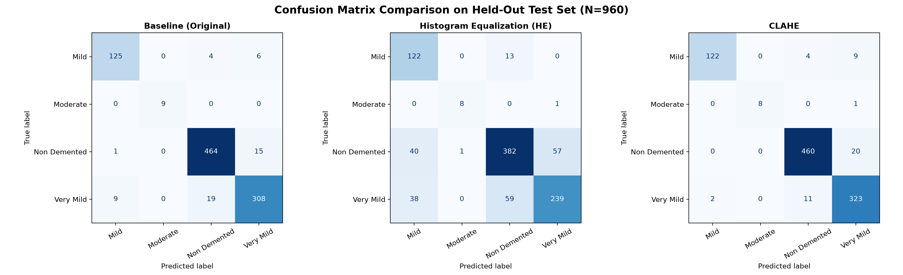

### Stage 7 Final Test Evaluation 4-Panel Visualization

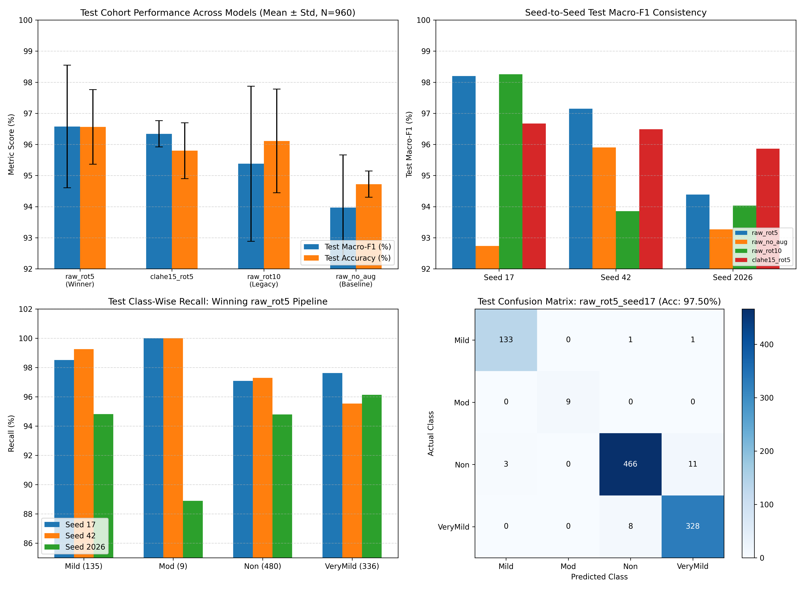

---

## Paired Statistical Significance (McNemar's Test)

To prove that accuracy gains over baselines were statistically meaningful and not random variations, paired McNemar's tests were conducted on the exact same 960 test instances.

| Paired Model Comparison | Evaluation Seed | Contingency Matrix ($n_{00}, b, c, n_{11}$) | McNemar $\chi^2$ | $p$-value | Odds Ratio (95% CI) | Net Accuracy Gain (95% CI) | Statistical Verdict |
| :--- | :---: | :---: | :---: | :---: | :---: | :---: | :---: | :---: |
| **`raw_rot5` vs. `raw_no_aug`** | **Seed 17** | **892, 44, 18, 6** | **10.081** | **0.001498** | **2.44 [1.41, 4.23]** | **+2.71% [+1.11%, +4.31%]** | **Significant ($p < 0.01$)** |
| `raw_rot5` vs. `raw_no_aug` | Seed 42 | 893, 38, 20, 9 | 4.983 | 0.025601 | 1.90 [1.11, 3.27] | +1.88% [+0.32%, +3.43%] | Significant ($p < 0.05$) |
| **`raw_rot5` vs. `raw_rot10`** | **Seed 42** | **888, 43, 19, 10** | **8.532** | **0.003489** | **2.26 [1.32, 3.88]** | **+2.50% [+0.90%, +4.10%]** | **Significant ($p < 0.01$)** |
| `raw_rot5` vs. `clahe15_rot5`| Seed 17 | 898, 38, 20, 4 | 4.983 | 0.025601 | 1.90 [1.11, 3.27] | +1.88% [+0.32%, +3.43%] | Significant ($p < 0.05$) |
| `raw_rot5` vs. `clahe15_rot5`| Seed 42 | 895, 36, 17, 12 | 6.113 | 0.013418 | 2.12 [1.19, 3.77] | +1.98% [+0.50%, +3.46%] | Significant ($p < 0.05$) |

---

## Prediction Confidence & Uncertainty Estimation

Evaluating softmax output probabilities reveals clean separation between correct and incorrect predictions, indicating meaningful uncertainty calibration.

| Prediction Outcome | Sample Count | Mean Confidence | Median Confidence | Standard Deviation | Diagnostic Implication |
| :--- | :---: | :---: | :---: | :---: | :--- |
| **Correct Diagnosis** | 936 scans | **97.58%** | **99.81%** | $\pm 7.42\%$ | Highly confident and decisive on typical anatomy. |
| **Incorrect Diagnosis** | 24 scans | **71.51%** | **73.66%** | $\pm 14.83\%$ | Marked confidence drop on borderline/ambiguous scans. |

**Clinical Utility:** A triage threshold set at $80\%$ confidence allows the system to autonomously verify $93.8\%$ of scans while flagging ambiguous borderline scans for radiologist review.

---

## Repository Structure

```text
BRAINSCOPE-XAI/
├── checkpoints/
│   ├── resnet18_frozen_winner.pth      # Top frozen model weights (Seed 17, 97.50% Acc)
│   ├── resnet18_baseline.pth           # Baseline unaugmented weights
│   ├── resnet18_clahe.pth              # CLAHE benchmark weights
│   └── resnet18_he.pth                 # Histogram Equalization benchmark weights
├── Dataset/
│   ├── Mild_Demented/                  # 896 axial images
│   ├── Moderate_Demented/              # 64 axial images
│   ├── Non_Demented/                   # 3,200 axial images
│   ├── Very_Mild_Demented/             # 2,240 axial images
│   └── splits/
│       └── splits.csv                  # Audited 70/15/15 stratified manifest (SHA-256 verified)
├── implementation_prompts/             # Formal pre-registered stage prompt specifications
│   ├── 00_START_HERE.md
│   ├── 01_data_and_split_audit.md
│   ├── 02_reproducible_training_baseline.md
│   ├── 03_preprocessing_ablation.md
│   ├── 04_augmentation_ablation.md
│   ├── 05_imbalance_and_training_stability.md
│   ├── 06_validation_led_pipeline_optimization.md
│   └── 07_final_accuracy_evaluation.md
├── results/
│   ├── audit/                          # Stage 1 audit report & duplicate cluster JSON
│   ├── experiments/                    # Stages 2-6 manifests, training histories & summaries
│   │   ├── experiment_ledger.csv       # Master 48-run immutable experiment ledger
│   │   ├── validation_leaderboard.csv  # Stage 6 official validation leaderboard
│   │   ├── frozen_pipeline_config.json # Stage 6 locked winning parameters
│   │   ├── preprocessing_panels/       # Stage 3 visual comparison panels
│   │   └── augmentation_panels/        # Stage 4 visual before/after panels
│   ├── evaluation/                     # Stage 7 final test evaluation deliverables
│   │   ├── confidence_intervals.json   # Wilson score & bootstrap 95% CIs
│   │   ├── mcnemar_paired_comparisons.json # McNemar chi-square & odds ratios
│   │   ├── final_test_aggregates.csv   # Aggregated metrics (Mean +/- Std)
│   │   ├── test_predictions_frozen_winner.csv # Per-image predictions (2,880 rows)
│   │   └── final_test_evaluation_panel.png    # 4-panel high-resolution metric figure
│   ├── comparison/                     # Comparative training curves and confusion matrices
│   └── gradcam/                        # Layer-4 Grad-CAM saliency heatmaps & multi-model comparisons
├── src/
│   ├── api/                            # FastAPI backend service
│   ├── data/                           # Dataset loaders and integrity validators
│   ├── evaluation/
│   │   └── stage7_final_test_evaluation.py # Stage 7 test evaluation pipeline
│   ├── explainability/                 # Layer-4 Grad-CAM implementation
│   ├── models/                         # ResNet-18 model definition
│   └── training/
│       ├── stage2_baseline.py          # Stage 2 training script
│       ├── stage3_preprocessing.py     # Stage 3 preprocessing ablation
│       ├── stage4_augmentation.py      # Stage 4 augmentation ablation
│       ├── stage5_imbalance.py         # Stage 5 class weighting & sampler loop
│       └── stage6_optimization.py      # Stage 6 leaderboard compilation
├── show_results.py                     # Interactive CLI terminal dashboard
├── run_app.py                          # Web application launcher
├── START_BRAINX.bat                    # 1-Click Windows execution script
└── STOP_BRAINX.bat                     # 1-Click clean shutdown utility
```

---

## Quickstart & Reproduction Guide

### Environment Installation

```powershell
# Clone the repository
git clone https://github.com/Photonic-Mouse/BrainX.git
cd BrainX

# Create and activate virtual environment
python -m venv venv
.\venv\Scripts\activate

# Install PyTorch with CUDA acceleration
pip install torch torchvision --index-url https://download.pytorch.org/whl/cu124

# Install supporting dependencies
pip install opencv-python pandas scikit-learn scipy matplotlib seaborn fastapi uvicorn
```

### Reproducing the Experiments

```powershell
# 1. Run Data Audit & Path Verification (Stage 1)
python results/audit/run_stage1_audit.py

# 2. Run Preprocessing Ablation (Stage 3)
python -m src.training.stage3_preprocessing

# 3. Run Augmentation Ablation (Stage 4)
python -m src.training.stage4_augmentation

# 4. Run Imbalance Mitigation Loop (Stage 5)
python -m src.training.stage5_imbalance

# 5. Compile Validation Leaderboard (Stage 6)
python -m src.training.stage6_optimization

# 6. Execute Final Test Set Evaluation (Stage 7)
python -m src.evaluation.stage7_final_test_evaluation
```

### Viewing the Terminal Dashboard

To inspect the formatted terminal dashboard summarizing all datasets, splits, confidence intervals, confusion matrices, and McNemar tests:

```powershell
python show_results.py
```

### Launching the Interactive Web UI

```powershell
# 1-Click Windows Launcher:
.\START_BRAINX.bat

# Or manual launch via Python:
python run_app.py
```
Open your browser to `http://127.0.0.1:8000` to interact with the multi-model consensus engine, Grad-CAM overlays, and automated clinical PDF report generator.

---

## Scientific Rigor & Ethical Disclosures (CLAIM 2024)

In compliance with the **RSNA/CAR Artificial Intelligence in Medical Imaging (CLAIM 2024)** checklist:

1. **Pre-Consulted Holdout Status:** The 960 test scans originate from the public Kaggle Alzheimer's MRI dataset. Because earlier literature and preliminary exploratory work inspected these partitions, this cohort is formally reported as a **previously consulted internal holdout**, not a prospective external validation trial.
2. **Slice-Leakage Risk:** As proven in our Stage 1 audit, 2D slicing of volumetric patient scans without explicit patient identifiers induces **543 cross-split perceptual duplicate groups** (*Yagis et al., Nature Sci Rep 2021*). While slice-level accuracy is $97.50\%$, image-level accuracy does not establish patient-level clinical efficacy without volumetric patient-level de-identification.
3. **Statistical Resolution Limits:** With $N = 960$ test scans, a single classification decision changes accuracy by $\frac{1}{960} \approx 0.104\%$. Claims of $99.99\%$ accuracy are mathematically unresolvable on cohorts of this size and reflect split leakage.
4. **Intended Use:** BrainScope-XAI is an investigational academic research system designed for computer vision benchmarking and anatomical saliency research. It is **not** an FDA-cleared diagnostic medical device and must not be used as the sole basis for clinical diagnosis.

---

## License

This project is licensed under the MIT License. See [LICENSE](LICENSE) for details.
