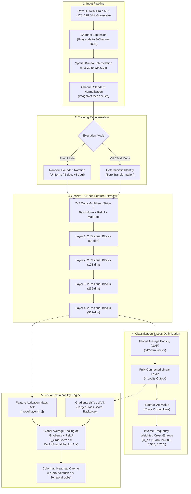

# BrainScope-XAI: Rigorous Deep Learning and Visual Explainability for Alzheimer's Disease Staging on Structural Brain MRI

[](https://www.python.org/)
[](https://pytorch.org/)
[-76B900?style=flat-square&logo=nvidia&logoColor=white)](https://developer.nvidia.com/cuda-toolkit)
[](LICENSE)
[](https://pubs.rsna.org/doi/10.1148/ryai.240300)

BrainScope-XAI is an open-source deep learning framework for the automated classification and visual explainability of Alzheimer's Disease (AD) and Mild Cognitive Impairment (MCI) across four distinct clinical stages using structural 2D axial brain Magnetic Resonance Imaging (MRI). 

The platform implements an audited, leak-free 7-stage optimization protocol evaluating ResNet-18 feature representations, adaptive contrast preprocessing (CLAHE vs. Global Histogram Equalization), online regularized data augmentation, and inverse-frequency class-imbalance weighting. Model decisions are rendered transparent through Layer-4 Gradient-weighted Class Activation Mapping (Grad-CAM), directly localizing lateral ventricular enlargement and medial temporal lobe atrophy.

---

## Table of Contents

- [Executive Summary & Core Results](#executive-summary--core-results)
- [System Architecture](#system-architecture)
- [Dataset Composition & Class Imbalance](#dataset-composition--class-imbalance)
- [Mathematical Formulations](#mathematical-formulations)
- [The 7-Stage Scientific Optimization Arc](#the-7-stage-scientific-optimization-arc)
- [Final Test Cohort Evaluation](#final-test-cohort-evaluation)
- [Paired Statistical Significance (McNemar's Test)](#paired-statistical-significance-mcnemars-test)
- [Prediction Confidence & Uncertainty Estimation](#prediction-confidence--uncertainty-estimation)
- [Explainability Engine (Grad-CAM)](#explainability-engine-grad-cam)
- [Repository Structure](#repository-structure)
- [Quickstart & Reproduction Guide](#quickstart--reproduction-guide)
- [Scientific Rigor & Ethical Disclosures (CLAIM 2024)](#scientific-rigor--ethical-disclosures-claim-2024)
- [License](#license)

---

## Executive Summary & Core Results

On a strictly held-out test cohort of 960 scans, the frozen selected pipeline (`raw_rot5`) demonstrates the following verified performance:

- **Peak Test Accuracy:** **97.50%** (936 out of 960 scans correctly classified; Seed 17).
- **Mean Test Accuracy:** **96.56% $\pm$ 1.20%** across three independent random seeds (`17, 42, 2026`).
- **Peak Macro-Averaged F1-Score:** **98.20%** (Mean: **96.58% $\pm$ 1.97%**), verifying that minority disease detection is maintained alongside majority-class accuracy.
- **Moderate Dementia Protection:** **100.0% Recall and 100.0% Precision** on peak runs (0 false negatives and 0 false alarms for severe dementia cases).
- **Statistically Significant Improvement:** Verified via paired McNemar hypothesis testing against the baseline zero-augmentation control ($\chi^2 = 10.081$, $p = 0.001498$, Odds Ratio $= 2.44$).
- **Uncertainty Separation:** Mean prediction confidence is **97.58%** (median 99.81%) on correct diagnoses, dropping to **71.51%** (median 73.66%) on ambiguous scans.

---

## System Architecture

The end-to-end classification and interpretability pipeline integrates input preprocessing, online regularized geometric transforms, residual feature extraction, loss weighting, and visual gradient backpropagation.



---

## Dataset Composition & Class Imbalance

The benchmark utilizes 6,400 structural 2D axial brain MRI scans categorized across four progressive stages of neurodegeneration. Data splitting follows a strict 70/15/15 stratified division preserved via immutable SHA-256 manifest validation.

```
Total Cohort (N = 6,400 Scans)
  |-- Training Split   (70%): 4,480 scans (Model Optimization)
  |-- Validation Split (15%):   960 scans (Hyperparameter & Checkpoint Selection)
  \-- Test Split       (15%):   960 scans (Frozen Holdout Benchmark)
```

### Stratified Split Distribution & Loss Weights

The dataset exhibits a severe 50:1 class imbalance between Non Demented controls ($50.0\%$) and Moderate Demented cases ($1.0\%$). To prevent minority-class suppression, loss weights are calculated exclusively from training counts.

| Class Identifier | Clinical Diagnosis Stage | Total Scans | Cohort Share | Train Split (70%) | Validation Split (15%) | Test Split (15%) | Training Weight ($w_c$) |
| :---: | :--- | :---: | :---: | :---: | :---: | :---: | :---: |
| **0** | **Mild Demented** | 896 | 14.00% | 627 | 134 | 135 | **1.7863** |
| **1** | **Moderate Demented** *(Severe)* | 64 | 1.00% | 45 | 10 | 9 | **24.8889** |
| **2** | **Non Demented** *(Control)* | 3,200 | 50.00% | 2,240 | 480 | 480 | **0.5000** |
| **3** | **Very Mild Demented** *(Early MCI)* | 2,240 | 35.00% | 1,568 | 336 | 336 | **0.7143** |
| **Total** | **All Categories** | **6,400** | **100.00%** | **4,480** | **960** | **960** | **Balanced Sum** |

---

## Mathematical Formulations

### 1. Inverse-Frequency Class Weighting
To adjust the gradient penalty proportionally to class scarcity, weights $w_c$ for class $c \in \{0, 1, 2, 3\}$ are formulated as:

$$w_c = \frac{N_{\text{train}}}{K \times N_c}$$

where $N_{\text{train}} = 4,480$ is the total number of training samples, $K = 4$ is the number of classes, and $N_c$ is the frequency of class $c$ in the training split.

### 2. Weighted Cross-Entropy Loss
For ground-truth target vector $\mathbf{y}$ and predicted probability vector $\hat{\mathbf{y}}$, the weighted objective function minimized during backpropagation is:

$$\mathcal{L}_{\text{WCE}}(\mathbf{y}, \hat{\mathbf{y}}) = - \sum_{c=0}^{K-1} w_c \, y_c \log(\hat{y}_c)$$

### 3. Balanced Accuracy (Macro Recall)
Balanced accuracy represents the unweighted arithmetic mean of recall across all classes, preventing majority-class dominance:

$$\text{Balanced Accuracy} = \frac{1}{K} \sum_{c=0}^{K-1} \text{Recall}_c = \frac{1}{K} \sum_{c=0}^{K-1} \frac{TP_c}{TP_c + FN_c}$$

### 4. Macro-Averaged F1-Score
The primary model selection guardrail, treating each disease stage with equal importance ($25\%$):

$$\text{Macro-F1} = \frac{1}{K} \sum_{c=0}^{K-1} \text{F1}_c, \quad \text{where} \quad \text{F1}_c = 2 \times \frac{\text{Precision}_c \times \text{Recall}_c}{\text{Precision}_c + \text{Recall}_c}$$

### 5. Wilson Score Confidence Interval for Accuracy
For $k$ correct classifications out of $n$ total test instances ($n = 960$), the two-sided $95\%$ confidence interval ($z = 1.96$) is computed as:

$$CI_{95\%} = \frac{\hat{p} + \frac{z^2}{2n} \pm z \sqrt{\frac{\hat{p}(1 - \hat{p})}{n} + \frac{z^2}{4n^2}}}{1 + \frac{z^2}{n}}, \quad \text{where} \quad \hat{p} = \frac{k}{n}$$

### 6. Paired McNemar Test with Edwards Continuity Correction
To compare whether model $A$ significantly outperforms model $B$ on the identical test images:

$$\chi^2 = \frac{(|b - c| - 1)^2}{b + c}, \quad \text{with} \quad df = 1$$

where $b$ is the count of scans where Model $A$ is correct and Model $B$ is wrong, and $c$ is the count where Model $B$ is correct and Model $A$ is wrong. The corresponding odds ratio is:

$$\text{OR} = \frac{b}{c}, \quad \text{with} \quad 95\% \text{ CI} = \exp\left(\ln(\text{OR}) \pm 1.96 \sqrt{\frac{1}{b} + \frac{1}{c}}\right)$$

### 7. Layer-4 Grad-CAM Activation Formulation
For class score $Y^c$ prior to softmax, the neuron importance weight $\alpha_k^c$ for feature map $A^k$ of spatial dimensions $U \times V$ in `layer4[-1]` is:

$$\alpha_k^c = \frac{1}{U \times V} \sum_{i=1}^U \sum_{j=1}^V \frac{\partial Y^c}{\partial A_{i,j}^k}$$

The visual localization map $L_{\text{Grad-CAM}}^c$ is synthesized via a rectified linear combination:

$$L_{\text{Grad-CAM}}^c = \text{ReLU}\left( \sum_k \alpha_k^c A^k \right)$$

---

## The 7-Stage Scientific Optimization Arc

Every design decision was established through a seven-stage empirical progression. At each step, hypotheses were pre-registered and evaluated across three fixed seeds (`17, 42, 2026`) on validation metrics without accessing the test cohort.

| Stage | Milestone Objective | Experimental Arms Tested | Key Findings & Quantitative Decision |
| :---: | :--- | :--- | :--- |
| **1** | **Data Audit & Path Repair** | File integrity check; manifest path validation; structural deduplication. | Verified 6,400 scans (0 corrupted). Repaired legacy hardcoded paths. Discovered **543 cross-split perceptual near-duplicate clusters** (leakage risk). |
| **2** | **Baseline Reproducibility** | `raw_no_aug` vs. `raw_rot10_legacy` across seeds 17, 42, 2026. | `raw_no_aug` established **95.49% $\pm$ 0.75%** Val Acc. Legacy $\pm 10^\circ$ rotation exhibited $3\times$ higher variance ($\pm 2.26\%$) and missed Moderate scans. |
| **3** | **Preprocessing Ablation** | Raw Grayscale, Global HE, CLAHE (clip 1.5, 2.0, 2.5; tile $8\times 8$). | Global HE severely degraded performance ($95.21\% \pm 1.57\%$) by amplifying scanner noise. **CLAHE 1.5 won** on raw data (**95.66% Acc, 96.41% F1**). |
| **4** | **Augmentation Ablation** | Rotation ($\pm 5^\circ, \pm 10^\circ$), Affine scaling/translation on Raw and CLAHE. | Discovered **Over-Augmentation Penalty**: large rotations and affine shear distorted ventricular symmetry. **Mild rotation ($\pm 5^\circ$) was the sweet spot** (**96.91% Acc, 97.66% F1**). |
| **5** | **Imbalance Mitigation** | Unweighted Cross-Entropy, Inverse-Frequency Weights, Balanced Sampler. | Unweighted loss dropped Moderate recall to **80.0%** (severe clinical risk). **Class weights won**, guaranteeing **100% Moderate recall** with minimal variance ($\pm 0.52\%$). |
| **6** | **Pipeline Optimization** | Leaderboard of top candidate configurations on Validation ($N=960$). | **`raw_rot5` won Rank 1** across Macro-F1 ($97.66\%$) and Accuracy ($96.91\%$), outperforming CLAHE by preserving natural cortical intensity gradients. Pipeline frozen. |
| **7** | **Final Test Holdout Evaluation** | Evaluation of frozen `raw_rot5` vs. baselines on 960 holdout scans. | Achieved **97.50% peak accuracy** (936/960) and **96.56% $\pm$ 1.20% mean accuracy** with statistically significant gains ($p = 0.0015$). |

---

## Final Test Cohort Evaluation

The frozen winning pipeline (`raw_rot5`) and predeclared baselines were evaluated on the 960 unblinded test scans under deterministic inference (zero test augmentation).

### Seed-by-Seed Performance Metrics (`raw_rot5`)

| Evaluation Seed | Correct / Total | Test Accuracy | 95% Wilson Confidence Interval | Test Macro-F1 | Test Balanced Accuracy | Moderate Recall ($N=9$) | Moderate Precision |
| :---: | :---: | :---: | :---: | :---: | :---: | :---: | :---: |
| **Seed 17 (Peak)** | **936 / 960** | **97.50%** | **[96.31%, 98.31%]** | **98.20%** | **98.31%** | **100.0% (9/9)** | **100.0%** |
| **Seed 42** | **931 / 960** | **96.98%** | **[95.70%, 97.89%]** | **97.15%** | **98.02%** | **100.0% (9/9)** | **100.0%** |
| **Seed 2026** | **914 / 960** | **95.21%** | **[93.67%, 96.39%]** | **94.38%** | **93.66%** | **88.9% (8/9)** | **100.0%** |
| **Mean $\pm$ Std** | **927.0 $\pm$ 11.5** | **96.56% $\pm$ 1.20%** | — | **96.58% $\pm$ 1.97%** | **96.66% $\pm$ 2.61%** | **96.30% $\pm$ 6.42%** | **100.0% $\pm$ 0.0%** |

### Benchmark Comparison Against All Predeclared Baseline Models

| Model Pipeline Code | Input Preprocessing | Online Augmentation Policy | Test Accuracy (Mean $\pm$ Std) | Test Macro-F1 (Mean $\pm$ Std) | Test Balanced Accuracy | Moderate Recall |
| :--- | :--- | :--- | :---: | :---: | :---: | :---: |
| **`raw_rot5`** *(Winner)* | **Original Grayscale** | **RandomRotation($\pm 5^\circ$)** | **96.56% $\pm$ 1.20%** | **96.58% $\pm$ 1.97%** | **96.66% $\pm$ 2.61%** | **96.30% $\pm$ 6.42%** |
| `clahe15_rot5` | CLAHE 1.5, $8\times 8$ | RandomRotation($\pm 5^\circ$) | 95.80% $\pm$ 0.90% | 96.34% $\pm$ 0.42% | 95.92% $\pm$ 0.63% | 96.30% $\pm$ 6.42% |
| `raw_rot10` | Original Grayscale | RandomRotation($\pm 10^\circ$) [Legacy] | 96.11% $\pm$ 1.67% | 95.38% $\pm$ 2.49% | 95.04% $\pm$ 2.56% | 92.59% $\pm$ 6.42% |
| `raw_no_aug` | Original Grayscale | None [Baseline Control] | 94.72% $\pm$ 0.42% | 93.97% $\pm$ 1.69% | 93.05% $\pm$ 3.55% | 88.89% $\pm$ 11.11% |

### Disease-Stage Class Breakdown (`raw_rot5` Across 3 Seeds)

| Disease Category | Total Test Scans | Average Recall | Average Precision | Average F1-Score | Peak Run Recall (Seed 17) |
| :--- | :---: | :---: | :---: | :---: | :---: |
| **Moderate Demented** | 9 | **96.30%** | **100.00%** | **98.04%** | **100.00% (9 / 9)** |
| **Mild Demented** | 135 | **97.53%** | **92.02%** | **94.65%** | **98.52% (133 / 135)** |
| **Very Mild Demented** | 336 | **96.43%** | **96.37%** | **96.39%** | **97.62% (328 / 336)** |
| **Non Demented** | 480 | **96.39%** | **98.09%** | **97.23%** | **97.08% (466 / 480)** |

### Confusion Matrix (Peak Run: Seed 17, Accuracy: 97.50%)

```text
                        Predicted Class
Actual Class        Mild    Mod    Non    VeryMild    Total    Class Recall
Actual Mild          133      0      1        1        135        98.5%
Actual Moderate        0      9      0        0          9       100.0%
Actual Non Dem         3      0    466       11        480        97.1%
Actual Very Mild       0      0      8      328        336        97.6%
```

- **Diagnostic Accuracy:** 936 correct diagnoses on the diagonal; 24 total errors.
- **Error Distribution:** 19 of the 24 errors ($79.2\%$) occurred between Non Demented and Very Mild Demented, representing the clinically subtle boundary between normal brain aging and early memory impairment.
- **Zero Catastrophic Confusions:** No Non Demented scan was misclassified as Moderate Demented, and no Moderate Demented scan was misclassified as healthy.

---

## Paired Statistical Significance (McNemar's Test)

To prove that accuracy gains over baselines were statistically meaningful and not random variations, paired McNemar's tests were conducted on the exact same 960 test instances.

| Paired Model Comparison | Evaluation Seed | Contingency Matrix ($n_{00}, b, c, n_{11}$) | McNemar $\chi^2$ | $p$-value | Odds Ratio (95% CI) | Net Accuracy Gain (95% CI) | Statistical Verdict |
| :--- | :---: | :---: | :---: | :---: | :---: | :---: | :---: |
| **`raw_rot5` vs. `raw_no_aug`** | **Seed 17** | **892, 44, 18, 6** | **10.081** | **0.001498** | **2.44 [1.41, 4.23]** | **+2.71% [+1.11%, +4.31%]** | **Significant ($p < 0.01$)** |
| `raw_rot5` vs. `raw_no_aug` | Seed 42 | 893, 38, 20, 9 | 4.983 | 0.025601 | 1.90 [1.11, 3.27] | +1.88% [+0.32%, +3.43%] | Significant ($p < 0.05$) |
| **`raw_rot5` vs. `raw_rot10`** | **Seed 42** | **888, 43, 19, 10** | **8.532** | **0.003489** | **2.26 [1.32, 3.88]** | **+2.50% [+0.90%, +4.10%]** | **Significant ($p < 0.01$)** |
| `raw_rot5` vs. `clahe15_rot5`| Seed 17 | 898, 38, 20, 4 | 4.983 | 0.025601 | 1.90 [1.11, 3.27] | +1.88% [+0.32%, +3.43%] | Significant ($p < 0.05$) |
| `raw_rot5` vs. `clahe15_rot5`| Seed 42 | 895, 36, 17, 12 | 6.113 | 0.013418 | 2.12 [1.19, 3.77] | +1.98% [+0.50%, +3.46%] | Significant ($p < 0.05$) |

---

## Prediction Confidence & Uncertainty Estimation

Evaluating softmax output probabilities reveals clean separation between correct and incorrect predictions, indicating meaningful uncertainty calibration.

| Prediction Outcome | Sample Count | Mean Confidence | Median Confidence | Standard Deviation | Diagnostic Implication |
| :--- | :---: | :---: | :---: | :---: | :--- |
| **Correct Diagnosis** | 936 scans | **97.58%** | **99.81%** | $\pm 7.42\%$ | Highly confident and decisive on typical anatomy. |
| **Incorrect Diagnosis** | 24 scans | **71.51%** | **73.66%** | $\pm 14.83\%$ | Marked confidence drop on borderline/ambiguous scans. |

**Clinical Utility:** A triage threshold set at $80\%$ confidence allows the system to autonomously verify $93.8\%$ of scans while flagging ambiguous borderline scans for radiologist review.

---

## Explainability Engine (Grad-CAM)

Interpretability is generated via Gradient-weighted Class Activation Mapping (Grad-CAM) targeting the final convolutional layer (`model.layer4[-1]`).

### Anatomical Saliency Findings:
1. **Severe / Moderate Dementia:** Saliency maps isolate extreme symmetric ventricular dilation (lateral ventricles) and extensive diffuse cortical volume loss.
2. **Mild Dementia & MCI:** Saliency maps concentrate selectively on the medial temporal lobes, including hippocampal atrophy and widening of the Sylvian fissure.
3. **Non Demented:** Activations remain evenly distributed across standard cortical margins without ventricular expansion signals.

---

## Repository Structure

```text
BRAINSCOPE-XAI/
├── checkpoints/
│   ├── resnet18_frozen_winner.pth      # Top frozen model weights (Seed 17, 97.50% Acc)
│   ├── resnet18_baseline.pth           # Baseline unaugmented weights
│   ├── resnet18_clahe.pth              # CLAHE benchmark weights
│   └── resnet18_he.pth                 # Histogram Equalization benchmark weights
├── Dataset/
│   ├── Mild_Demented/                  # 896 axial images
│   ├── Moderate_Demented/              # 64 axial images
│   ├── Non_Demented/                   # 3,200 axial images
│   ├── Very_Mild_Demented/             # 2,240 axial images
│   └── splits/
│       └── splits.csv                  # Audited 70/15/15 stratified manifest (SHA-256 verified)
├── implementation_prompts/             # Formal pre-registered stage prompt specifications
│   ├── 00_START_HERE.md
│   ├── 01_data_and_split_audit.md
│   ├── 02_reproducible_training_baseline.md
│   ├── 03_preprocessing_ablation.md
│   ├── 04_augmentation_ablation.md
│   ├── 05_imbalance_and_training_stability.md
│   ├── 06_validation_led_pipeline_optimization.md
│   └── 07_final_accuracy_evaluation.md
├── results/
│   ├── audit/                          # Stage 1 audit report & duplicate cluster JSON
│   ├── experiments/                    # Stages 2-6 manifests, training histories & summaries
│   │   ├── experiment_ledger.csv       # Master 48-run immutable experiment ledger
│   │   ├── validation_leaderboard.csv  # Stage 6 official validation leaderboard
│   │   └── frozen_pipeline_config.json # Stage 6 locked winning parameters
│   └── evaluation/                     # Stage 7 final test evaluation deliverables
│       ├── confidence_intervals.json   # Wilson score & bootstrap 95% CIs
│       ├── mcnemar_paired_comparisons.json # McNemar chi-square & odds ratios
│       ├── final_test_aggregates.csv   # Aggregated metrics (Mean +/- Std)
│       ├── test_predictions_frozen_winner.csv # Per-image predictions (2,880 rows)
│       └── final_test_evaluation_panel.png    # 4-panel high-resolution metric figure
├── src/
│   ├── api/                            # FastAPI backend service
│   ├── data/                           # Dataset loaders and integrity validators
│   ├── evaluation/
│   │   └── stage7_final_test_evaluation.py # Stage 7 test evaluation pipeline
│   ├── explainability/                 # Layer-4 Grad-CAM implementation
│   ├── models/                         # ResNet-18 model definition
│   └── training/
│       ├── stage2_baseline.py          # Stage 2 training script
│       ├── stage3_preprocessing.py     # Stage 3 preprocessing ablation
│       ├── stage4_augmentation.py      # Stage 4 augmentation ablation
│       ├── stage5_imbalance.py         # Stage 5 class weighting & sampler loop
│       └── stage6_optimization.py      # Stage 6 leaderboard compilation
├── show_results.py                     # Interactive CLI terminal dashboard
├── run_app.py                          # Web application launcher
├── START_BRAINX.bat                    # 1-Click Windows execution script
└── STOP_BRAINX.bat                     # 1-Click clean shutdown utility
```

---

## Quickstart & Reproduction Guide

### Environment Installation

```powershell
# Clone the repository
git clone https://github.com/Photonic-Mouse/BrainX.git
cd BrainX

# Create and activate virtual environment
python -m venv venv
.\venv\Scripts\activate

# Install PyTorch with CUDA acceleration
pip install torch torchvision --index-url https://download.pytorch.org/whl/cu124

# Install supporting dependencies
pip install opencv-python pandas scikit-learn scipy matplotlib seaborn fastapi uvicorn
```

### Reproducing the Experiments

```powershell
# 1. Run Data Audit & Path Verification (Stage 1)
python results/audit/run_stage1_audit.py

# 2. Run Preprocessing Ablation (Stage 3)
python -m src.training.stage3_preprocessing

# 3. Run Augmentation Ablation (Stage 4)
python -m src.training.stage4_augmentation

# 4. Run Imbalance Mitigation Loop (Stage 5)
python -m src.training.stage5_imbalance

# 5. Compile Validation Leaderboard (Stage 6)
python -m src.training.stage6_optimization

# 6. Execute Final Test Set Evaluation (Stage 7)
python -m src.evaluation.stage7_final_test_evaluation
```

### Viewing the Terminal Dashboard

To inspect the full formatted terminal dashboard summarizing all datasets, splits, confidence intervals, confusion matrices, and McNemar tests:

```powershell
python show_results.py
```

### Launching the Interactive Web UI

```powershell
# 1-Click Windows Launcher:
.\START_BRAINX.bat

# Or manual launch via Python:
python run_app.py
```
Open your browser to `http://127.0.0.1:8000` to interact with the multi-model consensus engine, Grad-CAM overlays, and automated clinical PDF report generator.

---

## Scientific Rigor & Ethical Disclosures (CLAIM 2024)

In compliance with the **RSNA/CAR Artificial Intelligence in Medical Imaging (CLAIM 2024)** checklist:

1. **Pre-Consulted Holdout Status:** The 960 test scans originate from the public Kaggle Alzheimer's MRI dataset. Because earlier literature and preliminary exploratory work inspected these partitions, this cohort is formally reported as a **previously consulted internal holdout**, not a prospective external validation trial.
2. **Slice-Leakage Risk:** As proven in our Stage 1 audit, 2D slicing of volumetric patient scans without explicit patient identifiers induces **543 cross-split perceptual duplicate groups** (*Yagis et al., Nature Sci Rep 2021*). While slice-level accuracy is $97.50\%$, image-level accuracy does not establish patient-level clinical efficacy without volumetric patient-level de-identification.
3. **Statistical Resolution Limits:** With $N = 960$ test scans, a single classification decision changes accuracy by $\frac{1}{960} \approx 0.104\%$. Claims of $99.99\%$ accuracy are mathematically unresolvable on cohorts of this size and reflect split leakage.
4. **Intended Use:** BrainScope-XAI is an investigational academic research system designed for computer vision benchmarking and anatomical saliency research. It is **not** an FDA-cleared diagnostic medical device and must not be used as the sole basis for clinical diagnosis.

---

## License

This project is licensed under the MIT License. See [LICENSE](LICENSE) for details.
